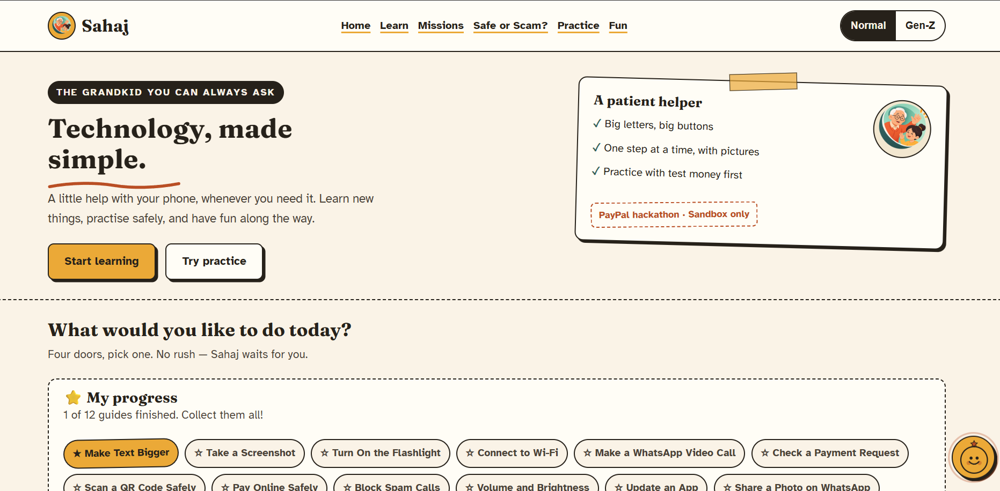
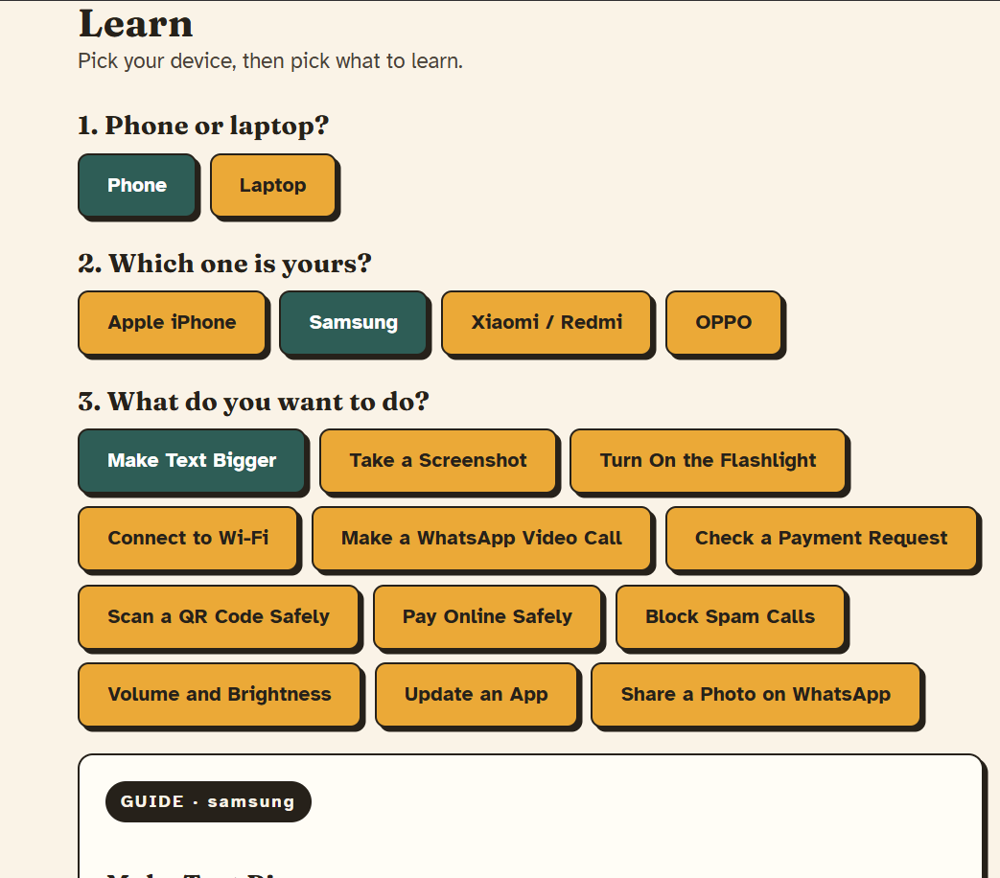
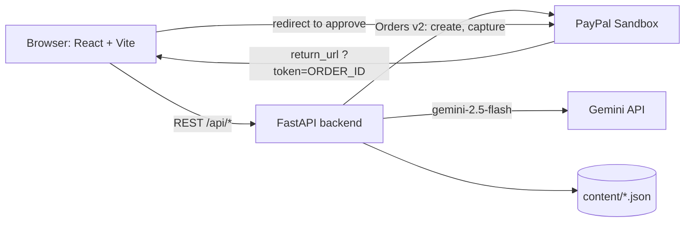

# Sahaj

**The grandkid you can always ask.**
*Learn it. Check it. Pay it safe.*

Sahaj ("easy" in Hindi) is an AI tech buddy for older adults. It gives step-by-step phone and laptop help with pictures, and it is the safe first step into digital payments: users learn, pause and check, then practice a real **PayPal Sandbox** checkout with test money. It speaks like a friendly Gen Z grandkid, with a **Normal** mode for plain talk.

Built for PayPal's **"Build What's Next with PayPal and AI"** hackathon.

> **Practice Mode uses PayPal Sandbox test money.** No real money is charged or moved. Buyers sign in with a Sandbox test account, never a real PayPal account.

<!-- Add screenshots here, e.g.




-->

---

## Why this exists

Paying online is where many older adults feel least confident, and scam messages target exactly that moment. Sahaj builds the habit before the real payment: a short loop that ends in a genuine PayPal checkout, in a place where nothing can go wrong.

## The Sahaj Pay Pass loop

| Stop | What happens | Where |
|---|---|---|
| 1. **Learn** | Step-by-step guides for the user's own device brand, with screenshots, read-aloud and "explain this step simply" | `/learn` |
| 2. **Pause & Check** | A "Hold up" screen with five tappable checks. The Pay button stays locked until all are ticked. There is also a trap scenario where the right answer is to walk away | Practice card on Home |
| 3. **Practice Pay** | Real PayPal Sandbox checkout (create order, approve, capture) with test money | `/practice/payment/success` |
| 4. **Prove it** | Animated *you → PayPal → seller* diagram, a plain-words receipt explanation, and a downloadable, shareable **Safe Payer certificate** | Success page and Home |

The scam game, missions, photo help and Ask Sahaj all feed this loop.

## Features

**Learn**
- 12 guides across 6 device brands (iPhone, Samsung, Xiaomi, OPPO, Windows, MacBook).
- Steps are looked up by brand first, then by platform, so each brand can have its own pictures.
- Read-aloud, a Gemini "Explain this step simply" button, per-step "Sahaj says" Gen Z notes, and "Ask family on WhatsApp" on every step.
- Finishing a guide triggers a celebration screen and completes any linked mission.

**Safe or Scam?**
- 16 shuffled scenarios shown as fake WhatsApp, SMS and UPI screens (5 genuine, 11 scams).
- After each answer, red and green flags are highlighted on the message itself.
- A paste-a-message checker that gives a LOW / MEDIUM / HIGH rating from a rule-based engine (no AI).

**Show Sahaj (photo help)**
- Upload or take a photo of a confusing screen. Gemini vision explains what it is, whether anything looks risky, and the next one to three safe taps.
- Images are checked (type, size up to 2 MB, magic bytes), held in memory for the request only, and **never stored**.

**Ask Sahaj**
- A floating button on every page opens a chat sheet with typing, photo, voice input and read-aloud.
- Questions pass through the safety checker first, and risky ones get a warning.

**Missions and Fun**
- 14 missions with a sticker collection, streak and "Today's mission".
- Tech word of the day, Gen Z words with desi analogies, an emoji quiz, a group-chat decoder, and WhatsApp sharing.

**Design**
- Warm notebook look, big tactile buttons, text of at least 19px, bundled fonts (Fraunces and Atkinson Hyperlegible), reduced-motion support, and a mobile bottom nav.
- **Normal / Gen Z** toggle that changes UI copy and the AI's voice.

## Architecture



**Tech stack:** FastAPI, Uvicorn, Pydantic, `google-genai`, `python-dotenv`, `httpx`, `python-multipart` on the backend. React 19, React Router 7, Vite 8 on the frontend. No UI library.

### How the PayPal flow works
1. The browser sends only an **item id**. Prices live on the server in `PRACTICE_ITEMS` (`practice-5` = $5.00, `chai-tip` = $1.00, `samosa-2` = $2.00).
2. The backend gets an OAuth token, creates a `CAPTURE` order in USD with return and cancel URLs built from `FRONTEND_URL`, and returns an `approval_url` (the `payer-action` or `approve` link).
3. The browser redirects to PayPal, the buyer approves with a Sandbox account, and PayPal redirects back to `/practice/payment/success?token=ORDER_ID`.
4. The frontend calls `POST /api/paypal/capture/{order_id}`. The backend reports success only when the status is `COMPLETED`, and handles a refresh (double capture) by looking the order up.

### What is real and what is simulated
| Real | Simulated or static |
|---|---|
| PayPal Sandbox order creation, approval and capture | The money is test money |
| Gemini explanations, chat, photo help and decoding | Scam scenarios are written by hand with fake names and masked numbers |
| Rule-based scam checker | Progress is browser-only (no accounts, no database) |

## Run it locally

### 1. Backend
```bash
cd backend
python -m venv venv
# Windows
.\venv\Scripts\activate
# macOS / Linux
source venv/bin/activate
pip install -r requirements.txt
```

Create `backend/.env` (never commit it):

```
PAYPAL_CLIENT_ID=your-sandbox-client-id
PAYPAL_CLIENT_SECRET=your-sandbox-client-secret
FRONTEND_URL=http://localhost:5173
GEMINI_API_KEY=your-key            # optional
# PAYPAL_BASE_URL defaults to https://api-m.sandbox.paypal.com
```

Run it:
```bash
python -m uvicorn app.main:app --reload
```
Swagger docs: http://127.0.0.1:8000/docs. Restart uvicorn after changing `.env`, because `--reload` does not watch it.

Without `GEMINI_API_KEY`, the app still works: every AI feature falls back to a short static message.

### 2. PayPal Sandbox accounts
1. In the PayPal Developer Dashboard, go to **Testing Tools → Sandbox Accounts**.
2. Create one **Business** and one **Personal** account, both with country **United States**.
3. Go to **Apps & Credentials → Sandbox → Create App** (type Merchant) and attach it to the Business account.
4. Put its Client ID and Secret in `backend/.env`.
5. On the PayPal approval page, sign in with the **Personal** (buyer) account.

> India-based Sandbox accounts can fail with "This seller doesn't accept payments in your currency", because PayPal restricts domestic INR payments. US-country Sandbox accounts with USD avoid this.

### 3. Frontend
```bash
cd frontend/frontend
npm install
npm run dev
```
Optional `frontend/frontend/.env`:
```
VITE_API_URL=http://127.0.0.1:8000
```
If it is missing, the app uses `http://127.0.0.1:8000`.

Build for production with `npm run build`.

### 4. Guide pictures (optional)
Put screenshots in `frontend/frontend/public/guides/<brand>/<guide_id>/stepN.png` (`.jpg`, `.jpeg` and `.webp` also work), then run, from `backend/`:

```bash
python link_guide_images.py --dry-run
python link_guide_images.py
```
This fills each step's `image` field in `backend/content/guides.json` and saves a `.bak` backup first. Restart the backend afterwards.

## API

| Method | Path | Purpose |
|---|---|---|
| GET | `/api/health` | Health check |
| GET | `/api/brands`, `/api/guides` | Device brands and guides |
| GET | `/api/guide/{id}?brand=&step=` | One guide step with image, tips and Gen Z note |
| POST | `/api/guide/explain` | Gemini explains a step |
| POST | `/api/ask` | Ask Sahaj chat, with safety warning |
| POST | `/api/safety/check` | Rule-based scam check |
| POST | `/api/show-sahaj` | Photo help (multipart, never stored) |
| POST | `/api/decode` | Group-chat slang decoder |
| GET | `/api/missions`, `/api/scam-quiz`, `/api/tips`, `/api/words`, `/api/genz`, `/api/emoji-quiz` | Content |
| GET | `/api/paypal/items`, `/api/paypal/check` | Practice items, Sandbox connection check |
| POST | `/api/paypal/create-order?item_id=` | Create Sandbox order, returns `approval_url` |
| POST | `/api/paypal/capture/{order_id}` | Capture an approved order |
| POST | `/api/explain-receipt` | Plain-words receipt explanation |

## Safety and privacy
- Prices and secrets stay on the server. The browser only sends an item id.
- Secrets come from environment variables only, and `.env` files are git-ignored.
- CORS allows only `http://localhost:5173` and `FRONTEND_URL`.
- Request inputs are validated and length-limited. Uploaded photos are type-, size- and content-checked, and are not stored or logged.
- The server stores nothing. Progress, streaks and the Pay Pass live in the browser's `localStorage`.
- AI prompts forbid asking for OTPs, PINs or passwords.

## Known limitations
Honest list, so nothing here is oversold:

- **Seven of the twelve guides** (payment request check, scan QR safely, pay online safely, block spam calls, volume and brightness, update an app, share a photo on WhatsApp) are marked `needs_checking`. They have no screenshots and are not brand-specific. The older guides mix `verified_official`, `community_sourced` and `needs_checking`.
- The scam checker is **English keyword-based**. Hindi or Hinglish scam text may score LOW, and the risk thresholds are arbitrary.
- PayPal is **USD and Sandbox only**. There is no real-money path.
- No authentication or rate limiting. This is a hackathon demo, not a production service.
- The certificate PNG falls back to system fonts, because web fonts do not embed in the canvas export.
- The scam helpline details shown at the end of the game (**1930** and **cybercrime.gov.in**) should be re-verified before any real-world use.
- Sahaj is a learning aid. It does not prevent fraud and is not financial advice.

## Project structure
```
backend/
  app/            main.py (routes), paypal.py, llm.py, safety.py, content.py
  content/        guides, missions, scam_quiz, tips, slang, emoji, genz (JSON)
  link_guide_images.py
frontend/frontend/
  src/            App.jsx, Learn, SafeOrScam, ScamGame, ScamChecker, Missions,
                  Fun, PauseCheck, ShowSahaj, PayPass, FloatingAsk, Mascot, copy
  public/         guides/ (step images), logo/
  vercel.json     SPA rewrite for deployment
```

## Deploy notes
- **Frontend (Vercel):** `vercel.json` rewrites all routes to `index.html` so refreshing `/learn` or `/practice/payment/success` works. Set `VITE_API_URL` to the backend URL.
- **Backend:** set the same variables from `backend/.env` on your host, with `FRONTEND_URL` set to the deployed frontend URL.

## License
This project is licensed under the MIT License. See the LICENSE file for details.
